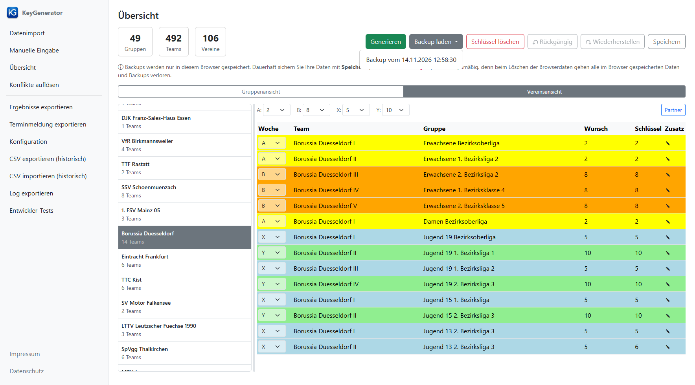

[← 6. Schlüsselzahlen generieren](06_generierung.md) | [Inhaltsverzeichnis](README.md) | [8. Typischer Arbeitsablauf →](08_arbeitsablauf.md)

---

# 7. Sonstige Funktionen

Sobald Daten geladen sind, stehen in der **Seitenleiste** folgende Funktionen zur Verfügung:

| Funktion | Beschreibung |
|----------|--------------|
| Ergebnisse exportieren | Exportiert die generierten Schlüsselzahlen als CSV-Datei mit Gruppen, Mannschaften, Schlüsselzahlen, Wunsch-Schlüsselzahlen, Spielwochen und Zusatz-Vorgaben. Falls die zugewiesene Schlüsselzahl nicht in der Wunschliste enthalten ist (Konflikt), wird dies in der Spalte "Wunsch" sichtbar. |
| Terminmeldung exportieren | Exportiert eine CSV-Datei mit Spieltag (Wochentag + Uhrzeit) und Ersatzspieltag je Mannschaft. Nützlich, um die Vollständigkeit der Terminmeldung zu überprüfen. |
| Konfiguration | Öffnet die Seite **Konfiguration**, auf der die Konfiguration (Spielpläne, Voreinstellungen der Referenzraster, Rastergrößen, Altersklassen, interne Spielwochen, max. Abweichung) bearbeitet, auf Plausibilität geprüft, importiert und exportiert werden kann. Siehe Abschnitt 7.4. |
| CSV exportieren (historisch) | Exportiert die Daten in ein älteres CSV-Format. |
| CSV importieren (historisch) | Importiert Daten aus einem älteren CSV-Format. |

## 7.1 Backup laden

Vor jeder Generierung wird automatisch eine Sicherheitskopie des aktuellen Datenstands im Browser-Speicher erstellt.
Falls Sie nach der Generierung einen Fehler bemerken, können Sie den vorherigen Zustand auf der **Übersicht** wiederherstellen:

1. Klicken Sie in der Übersicht auf das Dropdown-Menü **Backup laden**.
2. Wählen Sie die gewünschte Sicherheitskopie anhand des Zeitstempels aus.
3. Der geladene Zustand wird sofort wiederhergestellt.

Das Laden eines Backups blendet außerdem den Link **Konflikte auflösen** in der Seitenleiste aus (siehe [6.2 Konflikte auflösen](06_generierung.md#62-konflikte-aufloesen)).

> **Ansicht: Dropdown-Menü „Backup laden"**
>
> Das Dropdown-Menü "Backup laden" in der Übersicht nach einer Generierung: Es zeigt die verfügbaren Sicherheitskopien mit Zeitstempel an.
>
> 

**Hinweis:** Sicherheitskopien werden nur im Speicher dieses Browsers abgelegt und bleiben auch nach dem Neuladen der Seite erhalten. Ist der Speicher voll, werden die ältesten Sicherheitskopien zuerst entfernt. Beim Löschen der Browserdaten gehen sie verloren. Um den aktuellen Stand dauerhaft zu sichern, laden Sie die Daten regelmäßig über den Button **Speichern** als `Data.json` herunter.

## 7.2 Ergebnisse exportieren

Nach der Generierung können Sie die Ergebnisse als CSV-Datei herunterladen, um diese in einer übersichtlichen Form anzusehen (z.B. mit Microsoft Excel) und anschließend in Click-TT zu übertragen:

1. Klicken Sie in der Seitenleiste auf **Ergebnisse exportieren**.
2. Die Datei wird direkt in den Browser-Downloads-Ordner heruntergeladen.

In der exportierten CSV-Datei beginnt jede Gruppe mit einer Kopfzeile (Gruppenname und Rastergröße). Darauf folgt je Mannschaft eine Zeile mit den Spalten `Gruppe/Team;Schluessel;Wunsch;Spielwoche;Zusatz-Vorgaben`, also Mannschaftsname, zugewiesene Schlüsselzahl, Wunsch-Schlüsselzahlen, Spielwoche sowie Zusatzvorgaben je Spieltag. Die Spalte „Zusatz-Vorgaben" ist nur bei Mannschaften gefüllt, die an mindestens einem Spieltag eine Heimspiel-, Auswärtsspiel- oder Spielfrei-Vorgabe haben.
Falls die zugewiesene Schlüsselzahl nicht in der Wunschliste enthalten ist (Konflikt), wird dies in der Spalte "Wunsch" kenntlich gemacht.

## 7.3 Terminmeldung exportieren

Mit dieser Funktion können Sie die eingegebenen Terminmeldungen zur Überprüfung exportieren:

1. Klicken Sie in der Seitenleiste auf **Terminmeldung exportieren**.
2. Die Datei wird direkt in den Browser-Downloads-Ordner heruntergeladen.

Die erzeugte CSV-Datei enthält je Mannschaft den gemeldeten Spieltag (Wochentag und Uhrzeit) sowie den Ersatzspieltag.
Sie eignet sich dazu, die Vollständigkeit der Terminmeldung zu überprüfen.
Mit der Schlüsselzahlen-Generierung im engeren Sinne hat diese Zusatzfunktion nichts zu tun.

## 7.4 Konfiguration bearbeiten

Die Konfiguration legt fest, welche Spielpläne (Heim-/Auswärtsspieltage je Raster), Voreinstellungen der Referenzraster für neue Daten, minimale und maximale Rastergrößen sowie Altersklassen unterstützt werden. Sie enthält außerdem die Anzahl der Spielwochen, in denen interne Begegnungen bevorzugt werden sollen (`internalWeeks`, Standard: 3), sowie die maximale Anzahl an Spieltagen, an denen sich die Heim-/Auswärtsfolgen zweier Schlüsselzahlen unterscheiden dürfen, damit diese noch als „ähnlich" gelten (`maxDeviation`, Standard: 2).
Sie kann in der Anwendung bearbeitet, als Datei gespeichert und auf einem anderen Rechner oder in einer anderen Saison wiederverwendet werden.

**Konfiguration bearbeiten:**
1. Klicken Sie in der Seitenleiste auf **Konfiguration** (verfügbar, sobald Daten geladen sind). Es öffnet sich die Seite **Konfiguration** mit der aktuell gültigen Konfiguration. Als Voreinstellung der Referenzraster zeigt sie die aktuell eingestellten Referenzraster.
2. Passen Sie die Einstellungen an:
   - **Allgemein**: Min. Rastergröße, Max. Rastergröße, Referenzraster Woche A/B und Woche X/Y (Voreinstellung für neue Daten), Wochen für interne Duelle und Max. Abweichung (ähnlich). Rastergrößen werden aus Auswahllisten gewählt, die nur gerade Werte anbieten: die minimale und maximale Rastergröße von 2 bis 40, die Referenzraster von der minimalen bis zur maximalen Rastergröße.
   - **Altersklassen**: eine Altersklasse pro Zeile.
   - **Spielplan für Raster**: Wählen Sie die Rastergröße aus. Die Tabelle enthält eine Zeile je Schlüsselzahl und eine Spalte je Spieltag. Jede Zelle enthält `H` (Heimspiel) oder `A` (Auswärtsspiel) und die Schlüsselzahl des Gegners, z.B. `H6`. Die Zeile **Heim : Auswärts** zeigt je Spieltag die Anzahl der Heim- und Auswärtsspiele; ungleiche Werte sind rot hinterlegt. Zur Auswahl stehen alle geraden Rastergrößen von der minimalen bis zur maximalen Rastergröße. Wird die maximale Rastergröße erhöht, erscheint das neue Raster mit einem leeren Spielplan.
3. Klicken Sie auf **Prüfen**, um die Konfiguration zu prüfen (siehe unten).
4. Klicken Sie auf **Übernehmen**. Die Konfiguration wird nur übernommen, wenn sie gültig ist.

Solange Änderungen noch nicht übernommen sind, zeigt die Seite den Hinweis **Nicht übernommene Änderungen**. **Änderungen verwerfen** lädt wieder die aktuell gültige Konfiguration; auch beim Verlassen der Seite gehen nicht übernommene Änderungen verloren. Mit **Standard laden** wird die Standardkonfiguration auf die Seite geladen; übernommen wird sie erst mit **Übernehmen**.

**Plausibilitätsprüfung:** Beim Importieren, Prüfen, Übernehmen und Exportieren wird die Konfiguration geprüft. Neben Formfehlern (z.B. leere Altersklassen oder widersprüchliche Rastergrößen) wird geprüft, dass
- jede gerade Rastergröße von der minimalen bis zur maximalen Rastergröße einen vollständigen Spielplan hat, also eine Zeile für jede Schlüsselzahl; die minimale Rastergröße muss gerade sein,
- jede Schlüsselzahl an jedem Spieltag ihres Rasters ein Heim- oder Auswärtsspiel hat (bei Raster n sind das n − 1 Spieltage),
- an jedem Spieltag gleich viele Heim- wie Auswärtsspiele stattfinden,
- die Gegner zueinander passen: Spielt Schlüsselzahl 1 an einem Spieltag gegen 6, muss 6 an diesem Spieltag gegen 1 spielen, und eine der beiden hat ein Heim-, die andere ein Auswärtsspiel. Zwei Schlüsselzahlen treffen nur einmal aufeinander.

Alle gefundenen Probleme werden unter **Plausibilitätsprüfung** aufgelistet, z.B. „Raster 10, Spieltag 1: 4 Heim- und 6 Auswärtsspiele. Es müssen gleich viele sein.“ (siehe auch [9. Fehlerbehebung](09_fehlerbehebung.md)). Eine ungültige Konfiguration wird weder übernommen noch exportiert.

Beim Übernehmen werden alle bestehenden Einstellungen (Spielpläne, Voreinstellungen der Referenzraster, Rastergrößen, Altersklassen, interne Spielwochen, max. Abweichung) vollständig ersetzt. Die Checkbox **Interne Duelle möglichst vorziehen** auf der Seite „Datenimport" folgt dabei dem übernommenen Wert für die Wochen für interne Duelle.
Die Referenzraster bereits geladener Daten bleiben dabei erhalten. Nur wenn die neue Konfiguration für eines davon keinen Spielplan enthält, gilt ihre Voreinstellung; Schlüsselzahlen-Paare außerhalb des neuen Bereichs werden dann zurückgesetzt, und ein Hinweis nennt die betroffenen Vereine.
Um die Voreinstellungen der Referenzraster für neue Daten zu ändern, tragen Sie die gewünschten Werte unter **Allgemein** ein und klicken auf **Übernehmen**.

**Konfiguration exportieren:**
1. Klicken Sie auf der Seite **Konfiguration** auf **Exportieren**.
2. Die Konfiguration wird als JSON-Datei `Config.json` in den Browser-Downloads-Ordner heruntergeladen.

Exportiert wird die Konfiguration so, wie sie auf der Seite angezeigt wird, auch mit noch nicht übernommenen Änderungen.

**Konfiguration importieren:**
1. Klicken Sie auf der Seite **Konfiguration** auf **Importieren**.
2. Wählen Sie im Dateiauswahl-Dialog die gewünschte JSON-Konfigurationsdatei aus.

Die Konfiguration aus der Datei wird auf die Seite geladen und sofort geprüft. Angewendet wird sie erst mit **Übernehmen**; eine fehlerhafte Datei kann also zunächst auf der Seite korrigiert werden. Eine Datei, die keine Konfiguration im JSON-Format enthält, wird mit einer Fehlermeldung abgewiesen.

## 7.5 CSV exportieren und importieren (historisches Format)

Für den Austausch mit älteren Versionen des Programms steht ein CSV-basiertes Datenformat zur Verfügung.
Es besteht aus drei CSV-Dateien: `Staffeln.csv` (Gruppen und Mannschaften mit Schlüsselzahlen), `Vereine.csv` (Vereins-Schlüsselzahlen und Partnerschaften) und `Beziehungen.csv` (Spielwochen und Spieltagsvorgaben je Mannschaft).

**CSV exportieren:**
1. Klicken Sie in der Seitenleiste auf **CSV exportieren (historisch)**.
2. Die Dateien werden als eine ZIP-Datei `Historical.zip` in den Browser-Downloads-Ordner heruntergeladen.

**CSV importieren:**
1. Klicken Sie in der Seitenleiste auf **CSV importieren (historisch)**.
2. Wählen Sie im Dateiauswahl-Dialog die gewünschte ZIP-Datei aus.

Beachten Sie, dass dieses Format nur für die Kompatibilität mit älteren Programmversionen vorgesehen ist.
Es enthält keine Referenzraster; beim Import gelten die Voreinstellungen der Konfiguration.
Für die normale Nutzung empfiehlt sich das JSON-basierte Speicherformat (siehe [3.3 Laden aus Datei](03_datenimport.md#33-laden-aus-datei)).

---

[← 6. Schlüsselzahlen generieren](06_generierung.md) | [Inhaltsverzeichnis](README.md) | [8. Typischer Arbeitsablauf →](08_arbeitsablauf.md)
