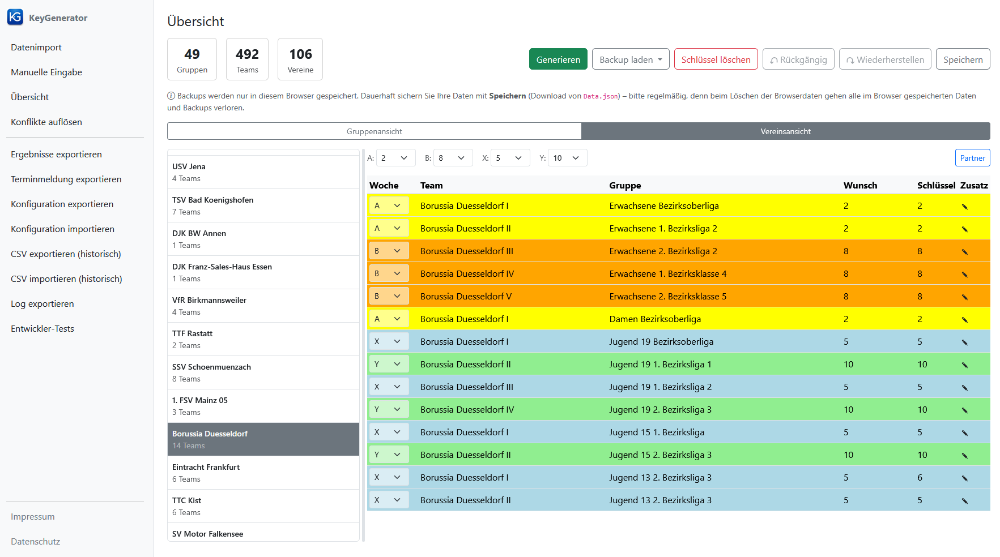

[← 10. Seitennavigation](10_navigation.md) | [Inhaltsverzeichnis](README.md) | [B. Download aus Click-TT →](B_download_aus_click-tt.md)

---

# Anhang A: Datenmodell

Zum besseren Verständnis der Anwendung wird hier das zugrundeliegende Datenmodell kurz erläutert.

## A.1 Verein

Zu einem Verein werden folgende Daten gespeichert:
- **Name**: Vereinsname (Umlaute werden automatisch ersetzt).
- **Schlüsselzahlen (A, B, X, Y)**: Zugeordnete Schlüsselzahlen auf Vereinsebene (0 bzw. leer = nicht zugeordnet). A und X liegen im Bereich des Referenzrasters ihres Spielwochenpaares, B und Y ergeben sich daraus als gegenläufige Schlüsselzahlen (siehe A.4).
- **Mannschaften**: Liste aller Mannschaften des Vereins über alle Gruppen hinweg.
- **Partnerschaften**: Beliebig viele Partnerschaften mit anderen Vereinen, jeweils bestehend aus eigener Spielwoche, Partnerverein und Spielwoche des Partnervereins (siehe [5.4 Partnerschaften](05_startbildschirm.md#54-partnerschaften)).

## A.2 Gruppe

Zu einer Gruppe werden folgende Daten gespeichert:
- **Name**: Bezeichnung der Gruppe (z.B. "Bezirksoberliga Erwachsene").
- **Rastergröße**: Die Rastergröße (in der Standardkonfiguration 6, 8, 10, 12 oder 14), die bestimmt, wie viele Schlüsselzahlen in dieser Gruppe vergeben werden.
- **Mannschaften**: Die in dieser Gruppe spielenden Teams (maximal so viele wie die Rastergröße).

## A.3 Mannschaft

Eine Mannschaft gehört zu genau einem Verein und genau einer Gruppe:
- **Name**: Vollständiger Name (Vereinsname + Mannschaftsnummer, meist als römische Zahl, z.B. "Borussia Duesseldorf II").
- **Spielwoche**: A, B, X, Y oder `-` (nicht zugeordnet).
- **Schlüsselzahl**: Die zugewiesene Schlüsselzahl (0 = nicht zugewiesen).
- **Spieltage**: Liste mit Vorgaben je Spieltag: Heimspiel, Auswärtsspiel oder keine Vorgabe. Außerdem werden hier die Spielfreiwünsche des Teams hinterlegt, die im Dialog „Zusatz" eingetragen werden (siehe [5.3 Zusätzliche Einstellungen für einzelne Teams](05_startbildschirm.md#53-zusaetzliche-einstellungen-fuer-einzelne-teams)).
- **Altersklasse**: Zugehörige Altersklasse (z.B. Erwachsene, Jugend 19, Senioren 40 usw.).
- **Terminmeldung**: Gemeldeter Spieltag (Wochentag und Uhrzeit) und Ersatzspieltag aus der Terminmeldung.

## A.4 Schlüsselzahlen und Spielplan

Die Schlüsselzahl eines Teams bestimmt dessen Spielplan, d.h. an welchen Spieltagen Heim- und Auswärtsspiele stattfinden.
Die Zuordnung zwischen Schlüsselzahlen und Spielplänen sowie die gültigen Rastergrößen und die Voreinstellungen der Referenzraster sind in einer voreingestellten Konfiguration hinterlegt, können aber angepasst werden (siehe [7.4 Konfiguration exportieren und importieren](07_sonstige_funktionen.md#74-konfiguration-exportieren-und-importieren)). Die eingestellten Referenzraster werden zusammen mit den Daten gespeichert.
Jede Schlüsselzahl liegt zwischen 1 und der Rastergröße ihrer Gruppe und darf in einer Gruppe höchstens einmal vergeben werden; das gilt auch für zwei Teams desselben Vereins mit derselben Spielwoche.

Zentrale Konzepte:
- **Gegenläufige Schlüsselzahlen**: Zwei Schlüsselzahlen Z1 und Z2 sind gegenläufig, wenn an jedem Spieltag gilt: Z1 hat genau dann ein Heimspiel, wenn Z2 ein Auswärtsspiel hat, und umgekehrt. A und B bzw. X und Y eines Vereins erhalten immer gegenläufige Schlüsselzahlen.
- **Parallele Schlüsselzahlen**: Bei unterschiedlichen Rastergrößen (z.B. Referenzraster vs. Gruppenraster) werden zwei Schlüsselzahlen Z1 und Z2 als parallel zueinander bezeichnet, wenn an keinem Spieltag Z1 ein Heimspiel und Z2 ein Auswärtsspiel hat, oder umgekehrt. Über parallele Schlüsselzahlen wird eine Vereins-Schlüsselzahl aus dem Referenzraster auf eine Gruppe mit anderer Rastergröße übertragen. Diese Zuordnung ist nicht immer eindeutig; gültig ist dann jede parallele Schlüsselzahl (z.B. vom 10er- ins 12er-Raster: 5 → 5 oder 6, 10 → 11 oder 12).
- **Ähnliche Schlüsselzahlen**: Schlüsselzahlen derselben Rastergröße, deren Spielpläne sich bzgl. ihres Musters für Heim- und Auswärtsspiele nur an wenigen Spieltagen unterscheiden (höchstens an so vielen, wie in der Konfiguration festgelegt, standardmäßig zwei). Mit den voreingestellten Spielplänen sind das zu einer Schlüsselzahl k die Zahlen k−1, k und k+1, wobei 1 und die Rastergröße als benachbart gelten (z.B. im 12er-Raster: 12, 1 und 2 zu 1). Ähnliche Schlüsselzahlen werden bei der Konfliktauflösung als Alternative angeboten und vergeben, wenn zwei Teams eines Vereins mit derselben Spielwoche in derselben Gruppe spielen.

> **Beispiel: Gegenläufige und parallele Schlüsselzahlen**
>
> Am Beispiel Borussia Düsseldorf lassen sich diese Konzepte gut veranschaulichen:
>
> 
>
> **Gegenläufige Schlüsselzahlen:** Der Verein hat Schlüsselzahl A=5 und B=11 (Referenzraster 12). Die Zahl 11 ist die gegenläufige Zahl zu 5 im 12er-Raster: Wenn Schlüsselzahl 5 an einem bestimmten Spieltag ein Heimspiel vorsieht, hat Schlüsselzahl 11 an diesem Spieltag ein Auswärtsspiel und umgekehrt. Ebenso gilt: X=5 und Y=10 sind gegenläufig im 10er-Raster.
>
> **Parallele Schlüsselzahlen:** Borussia Düsseldorf I spielt in der Bezirksoberliga (Rastergröße 12) mit Vereins-Schlüsselzahl A=5 und erhält die Mannschafts-Schlüsselzahl 5. Die Damen-Mannschaft spielt dagegen in einer Gruppe mit Rastergröße 10. Auch sie ist in Woche A und erhält ebenfalls Schlüsselzahl 5 – in diesem Fall ist die parallele Schlüsselzahl im 10er-Raster zufällig identisch. Wäre die Damen-Mannschaft der Woche B zugeordnet, würde sie die Schlüsselzahl 10 bekommen, da die Zahl 10 im 10er-Raster parallel zu den Zahlen 11 und 12 im 12er-Raster ist.
>
> **Ähnliche Schlüsselzahlen:** In der Jugend 13 2. Bezirksliga 3 spielen zwei Teams des Vereins in derselben Gruppe (Rastergröße 10), und sind beide der Spielwoche X zugeordnet. Das erste Team erhält die Schlüsselzahl 5, das zweite Team kann aber nicht ebenfalls Schlüsselzahl 5 erhalten und bekommt stattdessen die *ähnliche* Schlüsselzahl 4, die einen ähnlichen, aber nicht identischen Spielplan ergibt.

## A.5 Spielwochen

Die Spielwochen bestimmen, in welchem Rhythmus eine Mannschaft ihre Heimspiele austrägt.
Auf Vereinsebene wird pro Spielwoche eine Schlüsselzahl ermittelt, wobei für die jeweiligen Spielwochenpaare gegenläufige Schlüsselzahlen vergeben werden.
Für jede Mannschaft, die einer Spielwoche S zugeordnet ist, ist garantiert, dass sie eine Schlüsselzahl erhält, die zu derjenigen Schlüsselzahl ähnlich ist, die für ihren Verein für Spielwoche S vergeben wurde, oder mit dieser exakt übereinstimmt.

> **Beispiel: Spielwochenpaare A/B und X/Y**
>
> Der Verein Borussia Düsseldorf nutzt alle vier Spielwochen:
>
> | Woche | Altersklassen | Ref.-Raster | Vereins-SZ | Anz. Teams |
> |-------|---------------|-------------|------------|------------|
> | A | Erwachsene I & II, Damen | 12 | 5 | 3 |
> | B | Erwachsene III–V | 12 | 11 | 3 |
> | X | Jugend 19 I & III, 15 I, 13 I & II | 10 | 5 | 5 |
> | Y | Jugend 19 II & IV, 15 II | 10 | 10 | 3 |
>
> Die Erwachsenen-Mannschaften I und II und die Damen-Mannschaft spielen in Woche A, die Erwachsenen III–V in der gegenläufigen Woche B. So haben beide Gruppen abwechselnd Heimrecht in der Halle. Die Jugendmannschaften nutzen die Wochen X und Y, die einem anderen Spielrhythmus (Referenzraster 10) folgen.

---

[← 10. Seitennavigation](10_navigation.md) | [Inhaltsverzeichnis](README.md) | [B. Download aus Click-TT →](B_download_aus_click-tt.md)
