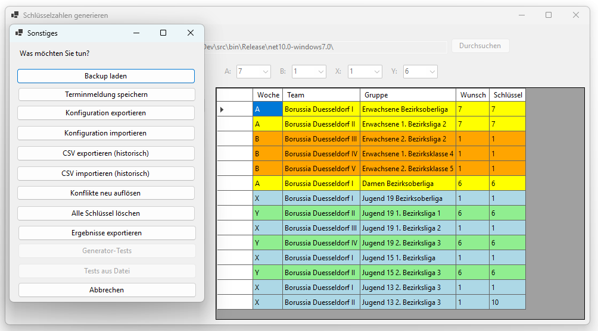

[← 6. Schlüsselzahlen generieren](06_generierung.md) | [Inhaltsverzeichnis](README.md) | [8. Typischer Arbeitsablauf →](08_arbeitsablauf.md)

---

# 7. Sonstige Funktionen

Über den Button **Sonstiges** auf dem Startbildschirm öffnet sich ein Fenster mit weiteren Funktionen:

| Funktion | Beschreibung |
|----------|--------------|
| Backup laden | Lädt eine zuvor gespeicherte Sicherheitskopie (z.B. den Stand vor der letzten Generierung). Siehe Abschnitt 7.1. |
| Terminmeldung speichern | Exportiert eine CSV-Datei mit Spieltag (Wochentag + Uhrzeit) und Ersatzspieltag je Mannschaft. Nützlich, um die Vollständigkeit der Terminmeldung zu überprüfen. |
| Konfiguration bearbeiten | Öffnet das Fenster **Konfiguration**, in dem die Konfiguration (Spielpläne, Voreinstellungen der Referenzraster, Rastergrößen, Altersklassen, interne Spielwochen, max. Abweichung) bearbeitet, auf Plausibilität geprüft, importiert und exportiert werden kann. Siehe Abschnitt 7.5. |
| CSV exportieren (historisch) | Exportiert die Daten in ein älteres CSV-Format. |
| CSV importieren (historisch) | Importiert Daten aus einem älteren CSV-Format. |
| Konflikte neu auflösen | Erkennt die Konflikte im aktuellen Datenstand, zusätzlich auch solche, die sich aus Spielplan-Einschränkungen (Heim-/Auswärts- und Spielfreivorgaben) ergeben, und ermöglicht deren Auflösung. Bestehende Schlüsselzahlzuweisungen bleiben dabei erhalten. |
| Alle Schlüssel löschen | Löscht alle zugewiesenen Mannschafts- und Vereins-Schlüsselzahlen. Diese Aktion kann über **Rückgängig** rückgängig gemacht werden. Siehe Abschnitt 7.7. |
| Ergebnisse exportieren | Exportiert die generierten Schlüsselzahlen als CSV-Datei mit Gruppen, Mannschaften, Schlüsselzahlen, Wunsch-Schlüsselzahlen, Spielwochen und Zusatz-Vorgaben. Falls die zugewiesene Schlüsselzahl nicht in der Wunschliste enthalten ist (Konflikt), wird dies in der Spalte "Wunsch" sichtbar. |
| Generator-Tests | Startet automatisierte Tests des Generierungsalgorithmus (für die normale Anwendung nicht notwendig). |
| Tests aus Datei | Führt Tests aus, die in Testdateien (`*.csv`) definiert sind (für die normale Anwendung nicht notwendig). Die Testdateien liegen in einem eigenen Ordner, der über einen Ordnerauswahldialog (ausgehend vom eingestellten Verzeichnis) ausgewählt wird; Dateien, die keine gültigen Testdateien sind, werden nach dem Testlauf aufgelistet. |
| Abbrechen | Schließt das Fenster und kehrt zum Startbildschirm zurück. |

> **Ansicht: Fenster „Sonstiges"**
>
> Das Fenster „Sonstiges" mit der Auflistung aller Zusatzfunktionen, erreichbar über den gleichnamigen Button auf dem Startbildschirm.
>
> 

## 7.1 Backup laden

Vor jeder Generierung wird automatisch eine Sicherheitskopie des aktuellen Datenstands erstellt.
Falls Sie nach der Generierung einen Fehler bemerken, können Sie den vorherigen Zustand wiederherstellen:

1. Klicken Sie auf **Sonstiges** im Startbildschirm.
2. Klicken Sie auf **Backup laden**.
3. Es öffnet sich ein Dateidialog, der automatisch den Unterordner `Backup` im eingestellten Verzeichnis vorauswählt. Wählen Sie dort die gewünschte Sicherheitskopie (JSON-Datei) aus.
4. Der geladene Zustand wird sofort wieder abgespeichert.

## 7.2 Ergebnisse exportieren

Nach der Generierung können Sie die Ergebnisse als CSV-Datei speichern, um die Ergebnisse in einer übersichtlichen Form ansehen (z.B. mit Microsoft Excel) und anschließend in Click-TT übertragen zu können:

1. Klicken Sie auf **Sonstiges** im Startbildschirm.
2. Klicken Sie auf **Ergebnisse exportieren**.
3. Wählen Sie im Dateidialog den gewünschten Speicherort und Dateinamen.

In der exportierten CSV-Datei beginnt jede Gruppe mit einer Kopfzeile (Gruppenname und Rastergröße). Darauf folgt je Mannschaft eine Zeile mit den Spalten `Gruppe/Team;Schluessel;Wunsch;Spielwoche;Zusatz-Vorgaben`, also Mannschaftsname, zugewiesene Schlüsselzahl, Wunsch-Schlüsselzahlen, Spielwoche sowie Zusatzvorgaben je Spieltag. Die Spalte „Zusatz-Vorgaben" ist nur bei Mannschaften gefüllt, die an mindestens einem Spieltag eine Heimspiel-, Auswärtsspiel- oder Spielfrei-Vorgabe haben.
Falls die zugewiesene Schlüsselzahl nicht in der Wunschliste enthalten ist (Konflikt), wird dies in der Spalte "Wunsch" kenntlich gemacht.

## 7.3 Terminmeldung speichern

Mit dieser Funktion können Sie die eingegebenen Terminmeldungen zur Überprüfung exportieren:

1. Klicken Sie auf **Sonstiges** im Startbildschirm.
2. Klicken Sie auf **Terminmeldung speichern**.
3. Wählen Sie im Dateidialog den gewünschten Speicherort und Dateinamen.

Die erzeugte CSV-Datei enthält je Mannschaft den gemeldeten Spieltag (Wochentag und Uhrzeit) sowie den Ersatzspieltag.
Sie eignet sich dazu, die Vollständigkeit der Terminmeldung zu überprüfen. 
Mit der Schlüsselzahlen-Generierung im engeren Sinne hat diese Zusatzfunktion nichts zu tun.

## 7.4 Konflikte neu auflösen

Diese Funktion ermöglicht es, nach einer erfolgten Generierung Konflikte erneut zu erkennen und zu beheben. Dabei werden zusätzlich Konflikte erkannt, die sich aus den Spielplan-Einschränkungen ergeben (Heim-/Auswärtsspielvorgaben sowie Spielfreiwünsche):

1. Klicken Sie auf **Sonstiges** im Startbildschirm.
2. Klicken Sie auf **Konflikte neu auflösen**.
3. Es erscheint ein Dialogfenster zur Auflösung von Konflikten (siehe [6.1 Konflikte beheben](06_generierung.md#61-konflikte-beheben))

Im Gegensatz zu einer vollständigen Neu-Generierung bleiben dabei die bereits vorgenommenen Schlüsselzahlzuweisungen erhalten.
Die Konflikte werden stets aus dem aktuellen Datenstand ermittelt.

## 7.5 Konfiguration bearbeiten

Die Konfiguration legt fest, welche Spielpläne (Heim-/Auswärtsspieltage je Raster), Voreinstellungen der Referenzraster für neue Daten, minimale und maximale Rastergrößen sowie Altersklassen unterstützt werden. Sie enthält außerdem die Anzahl der Spielwochen, in denen interne Begegnungen bevorzugt werden sollen (`internalWeeks`, Standard: 3), sowie die maximale Anzahl an Spieltagen, an denen sich die Heim-/Auswärtsfolgen zweier Schlüsselzahlen unterscheiden dürfen, damit diese noch als „ähnlich" gelten (`maxDeviation`, Standard: 2).
Sie kann im Programm bearbeitet, als Datei gespeichert und auf einem anderen Rechner oder in einer anderen Saison wiederverwendet werden.

**Konfiguration bearbeiten:**
1. Klicken Sie auf **Sonstiges** im Startbildschirm.
2. Klicken Sie auf **Konfiguration bearbeiten**. Es öffnet sich das Fenster **Konfiguration** mit der aktuell gültigen Konfiguration. Als Voreinstellung der Referenzraster zeigt es die aktuell eingestellten Referenzraster. Unter **Plausibilitätsprüfung** steht sofort das Prüfergebnis dieser Konfiguration.
3. Passen Sie die Einstellungen an:
   - **Allgemein**: Min. Rastergröße, Max. Rastergröße, Referenzraster Woche A/B und Woche X/Y (Voreinstellung für neue Daten), Wochen für interne Duelle und Max. Abweichung (ähnlich). Rastergrößen werden aus Auswahllisten gewählt, die nur gerade Werte anbieten: die minimale und maximale Rastergröße von 2 bis 40, die Referenzraster von der minimalen bis zur maximalen Rastergröße. Steht in einer importierten Datei ein Wert, der nicht angeboten wird, wird er zusätzlich angezeigt, bis Sie einen gültigen Wert wählen. Die Wochen für interne Duelle dürfen höchstens so groß sein wie die Anzahl der Spieltage des kleinsten Rasters (minimale Rastergröße − 1); 0 bedeutet, dass interne Duelle nicht vorgezogen werden. Denselben Wert stellen Sie auch im Hauptfenster über **Interne Duelle möglichst vorziehen bis Spielwoche:** ein (siehe [6. Schlüsselzahlen generieren](06_generierung.md)).
   - **Altersklassen**: eine Altersklasse pro Zeile.
   - **Spielplan für Raster**: Wählen Sie die Rastergröße aus. Die Tabelle enthält eine Zeile je Schlüsselzahl und eine Spalte je Spieltag. Jede Zelle enthält `H` (Heimspiel) oder `A` (Auswärtsspiel) und die Schlüsselzahl des Gegners, z.B. `H6`. Zellen mit Heimspiel sind grün, Zellen mit Auswärtsspiel blau und ungültige Einträge rot hinterlegt. Die Zeile **Heim : Auswärts** zeigt je Spieltag die Anzahl der Heim- und Auswärtsspiele; sie ist rot hinterlegt, wenn die Anzahlen ungleich sind oder an diesem Spieltag nicht jede Schlüsselzahl ein Spiel hat. Zur Auswahl stehen alle geraden Rastergrößen von der minimalen bis zur maximalen Rastergröße sowie jede weitere Rastergröße bis zur maximalen, für die ein Spielplan vorhanden ist (z.B. aus einer importierten Datei). Wird die maximale Rastergröße erhöht, erscheint das neue Raster mit einem leeren Spielplan.
4. Klicken Sie auf **Prüfen**, um die Konfiguration zu prüfen (siehe unten).
5. Klicken Sie auf **Übernehmen**. Ist die Konfiguration gültig, wird sie übernommen und das Fenster geschlossen. Ist sie ungültig, erscheint ein Hinweis, die Probleme werden unter **Plausibilitätsprüfung** aufgelistet, und das Fenster bleibt geöffnet. **Abbrechen** schließt das Fenster, ohne etwas zu ändern.

Mit **Standard laden** wird die mitgelieferte Standardkonfiguration in das Fenster geladen; übernommen wird sie erst mit **Übernehmen**.

**Plausibilitätsprüfung:** Beim Importieren, Prüfen, Übernehmen und Exportieren wird die Konfiguration geprüft. Neben Formfehlern (z.B. leere Altersklassen oder widersprüchliche Rastergrößen) wird geprüft, dass
- jede gerade Rastergröße von der minimalen bis zur maximalen Rastergröße einen vollständigen Spielplan hat, also eine Zeile für jede Schlüsselzahl; die minimale Rastergröße muss gerade sein,
- jede Schlüsselzahl an jedem Spieltag ihres Rasters ein Heim- oder Auswärtsspiel hat (bei Raster n sind das n − 1 Spieltage),
- an jedem Spieltag gleich viele Heim- wie Auswärtsspiele stattfinden,
- die Gegner zueinander passen: Spielt Schlüsselzahl 1 an einem Spieltag gegen 6, muss 6 an diesem Spieltag gegen 1 spielen, und eine der beiden hat ein Heim-, die andere ein Auswärtsspiel. Zwei Schlüsselzahlen treffen nur einmal aufeinander,
- die Wochen für interne Duelle die Anzahl der Spieltage des kleinsten Rasters (minimale Rastergröße − 1) nicht überschreiten.

Alle gefundenen Probleme werden unter **Plausibilitätsprüfung** aufgelistet, z.B. „Raster 10, Spieltag 1: 4 Heim- und 6 Auswärtsspiele. Es müssen gleich viele sein.“ (siehe auch [9. Fehlerbehebung](09_fehlerbehebung.md)). Eine ungültige Konfiguration wird weder übernommen noch exportiert.

Beim Übernehmen werden alle bestehenden Einstellungen (Spielpläne, Voreinstellungen der Referenzraster, Rastergrößen, Altersklassen, interne Spielwochen, max. Abweichung) vollständig ersetzt. Die übernommene Konfiguration wird auch beim nächsten Programmstart wieder verwendet.
Die Referenzraster bereits geladener Daten bleiben dabei erhalten. Nur wenn die neue Konfiguration für eines davon keinen Spielplan enthält, gilt ihre Voreinstellung; Schlüsselzahlen-Paare außerhalb des neuen Bereichs werden dann zurückgesetzt, und eine Meldung nennt die betroffenen Vereine.
Um die Voreinstellungen der Referenzraster für neue Daten zu ändern, tragen Sie die gewünschten Werte unter **Allgemein** ein und klicken auf **Übernehmen**.

**Konfiguration exportieren:**
1. Klicken Sie im Fenster **Konfiguration** auf **Exportieren…**.
2. Wählen Sie im Dateidialog den gewünschten Speicherort und Dateinamen (vorgeschlagen wird `Config.json`). Die Konfiguration wird als JSON-Datei gespeichert.

Exportiert wird die Konfiguration so, wie sie im Fenster angezeigt wird, auch mit noch nicht übernommenen Änderungen.

**Konfiguration importieren:**
1. Klicken Sie im Fenster **Konfiguration** auf **Importieren…**.
2. Wählen Sie im Dateidialog die gewünschte JSON-Konfigurationsdatei aus.

Die Konfiguration aus der Datei wird in das Fenster geladen und sofort geprüft. Angewendet wird sie erst mit **Übernehmen**; eine fehlerhafte Datei kann also zunächst im Fenster korrigiert werden. Eine Datei, die keine Konfiguration im JSON-Format enthält, wird mit einer Fehlermeldung abgewiesen.

## 7.6 CSV exportieren und importieren (historisches Format)

Für den Austausch mit älteren Versionen des Programms steht ein CSV-basiertes Datenformat zur Verfügung.
Es besteht aus drei CSV-Dateien: `Staffeln.csv` (Gruppen und Mannschaften mit Schlüsselzahlen), `Vereine.csv` (Vereins-Schlüsselzahlen und Partnerschaften) und `Beziehungen.csv` (Spielwochen und Spieltagsvorgaben je Mannschaft).

**CSV exportieren:**
1. Klicken Sie auf **Sonstiges** im Startbildschirm.
2. Klicken Sie auf **CSV exportieren (historisch)**.
3. Wählen Sie im Verzeichnisdialog den gewünschten Speicherort aus.

**CSV importieren:**
1. Klicken Sie auf **Sonstiges** im Startbildschirm.
2. Klicken Sie auf **CSV importieren (historisch)**.
3. Wählen Sie im Verzeichnisdialog den Speicherort der jeweiligen CSV-Dateien aus.

Beachten Sie, dass dieses Format nur für die Kompatibilität mit älteren Programmversionen vorgesehen ist.
Es enthält keine Referenzraster; beim Import gelten die Voreinstellungen der Konfiguration.
Für die normale Nutzung empfiehlt sich das JSON-basierte Speicherformat (siehe [4.3 Laden aus Datei](04_datenimport.md#43-laden-aus-datei)).

## 7.7 Alle Schlüssel löschen

Mit dieser Funktion werden alle zugewiesenen Mannschafts- und Vereins-Schlüsselzahlen auf einmal entfernt:

1. Klicken Sie auf **Sonstiges** im Startbildschirm.
2. Klicken Sie auf **Alle Schlüssel löschen**.
3. Es erscheint eine Sicherheitsabfrage. Bestätigen Sie die Aktion.

Die Löschung kann über **Strg+Z** (Rückgängig) jederzeit rückgängig gemacht und über **Strg+Y** (Wiederherstellen) wiederhergestellt werden.

---

[← 6. Schlüsselzahlen generieren](06_generierung.md) | [Inhaltsverzeichnis](README.md) | [8. Typischer Arbeitsablauf →](08_arbeitsablauf.md)
